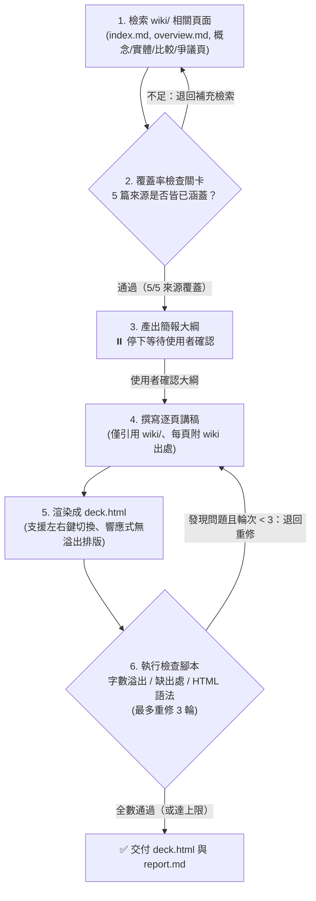

# Workflow: Wiki-to-Deck（Graph + Loop 簡報生成流程）

本工作流程規範如何**僅使用 `wiki/` 內的資料**，產出給「完全不懂光學的新手」閱讀的教學型 HTML 簡報（`deck.html`），並透過覆蓋率關卡與自動化檢查腳本迴圈確保品質。

## 流程圖（Graph + Loop）

---

## 各步驟執行規範

1. **步驟 1：檢索 `wiki/` 相關頁面**
   - 讀取 `wiki/index.md` 與 `wiki/overview.md` 鎖定脈絡，並依主題讀取 `wiki/sources/`、`wiki/concepts/`、`wiki/entities/`、`wiki/comparisons/`、`wiki/claims/`。
   - **禁止**直接讀取或引用未經 `wiki/` 編譯的外部資訊。
2. **步驟 2：覆蓋率檢查關卡（Loop 1）**
   - 檢查所選頁面是否完整涵蓋以下 5 篇來源的核心知識：
     1. `01_Cochrane_抗藍光眼鏡系統性回顧`
     2. `02_AAO_電腦眼鏡與藍光立場聲明`
     3. `03_衛福部國健署_3C藍光與兒童視力`
     4. `04_ZENOTTIC_抗藍光眼鏡與夜間模式比較`
     5. `05_Wikipedia_抗反射鍍膜光學原理`
   - 若任一來源未涵蓋，退回步驟 1 補齊，並將檢查結果記錄於 `report.md`。
3. **步驟 3：產出簡報大綱（Human-in-the-loop 暫停點）**
   - 以新手友善的敘事順序規劃投影片大綱（每頁標題、核心白話重點、對應 `wiki/` 來源）。
   - **必須暫停**並請使用者確認大綱後，方可進入步驟 4。
4. **步驟 4：撰寫逐頁稿**
   - 嚴格遵守「僅引用 `wiki/` 內容」原則，將光學術語轉譯為新手易懂的比喻與圖解概念。
   - 每一頁底部都必須明確標註對應的 `wiki/` 來源出處（頁面名稱）。
5. **步驟 5：渲染成 `deck.html`**
   - 產出單一獨立可離線開啟的 `deck.html`，支援鍵盤左／右方向鍵切換頁面、頁碼進度指示、視覺化對比卡片／表格，並確保版面不會文字溢出。
6. **步驟 6：執行檢查腳本（Loop 2，最多 3 輪）**
   - 以自動化腳本檢查每頁：
     1. 字數與行數是否過多導致溢出風險（例如單頁純文字字數上限、清單項目數上限）。
     2. 每頁是否皆有標註 `wiki/` 來源出處。
     3. HTML 標籤開關、結構與腳本語法是否正常。
   - 若有任何一項未通過，將具體錯誤記錄於 `report.md` 並退回步驟 4 修正，最多重修 3 輪。
